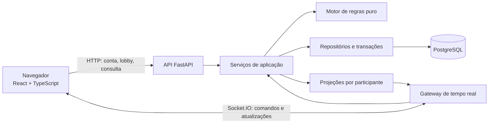
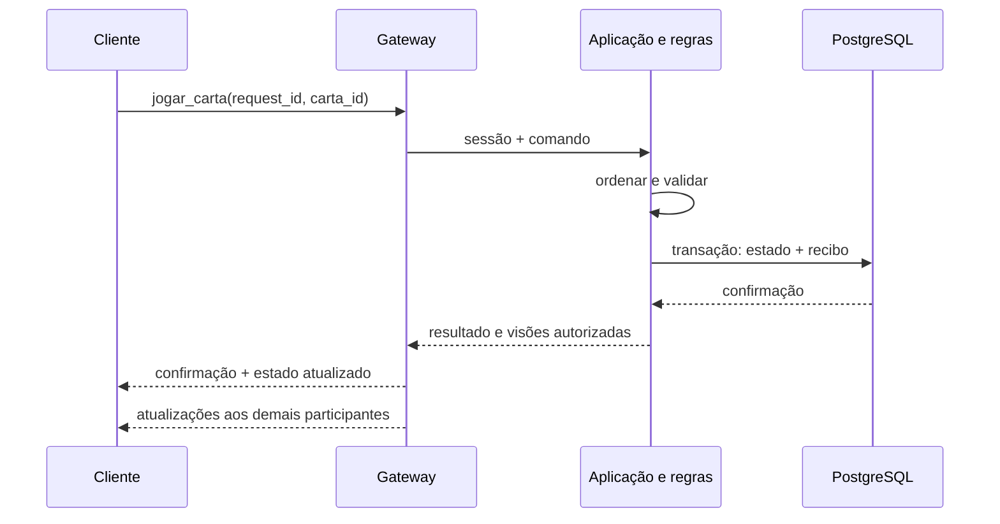

# Arquitetura proposta da primeira versão — Caô!

**Data:** 16/11/2026

**Status:** aprovada pelo responsável pelo produto em 16/11/2026; base inicial em desenvolvimento.

**Base:** [requisitos aprovados](../01-requisitos/requisitos.md), [stack aprovada](../memoria/DECISOES.md#d-001--stack-da-primeira-versão) e [pesquisa técnica](../04-pesquisas/viabilidade-tecnica.md).

## Objetivo e limites

Permitir partidas privadas por turnos com 2 a 10 pessoas por sala, contando espectadores, sem revelar mãos indevidas e sem perder a partida após uma queda do processo. A primeira versão usa **um processo servidor** e um banco PostgreSQL; três salas simultâneas de dez pessoas são o alvo inicial de verificação. A arquitetura separa regras de jogo, transporte e banco para que cada parte possa ser testada isoladamente. Escala para vários processos fica condicionada a medições e a um projeto de coordenação entre instâncias.

## Visão dos componentes

| Parte | Responsabilidade |
| --- | --- |
| Navegador | Exibir lobby, mesa, mãos permitidas e resultado; enviar intenções com identificador único; reconciliar a tela pelo estado recebido. Não decide validade, cartas compradas ou vencedor. |
| API HTTP | Cadastro, login/logout, consulta de perfil e estatísticas, criação/entrada por convite, leitura inicial da sala. |
| Gateway Socket.IO | Autenticar conexão, receber comandos, devolver confirmação ou rejeição e distribuir visões autorizadas. A sala do Socket.IO é canal de entrega, não a fonte da verdade. |
| Serviços de aplicação | Ordenar ações da sala, verificar permissão e fase, chamar regras, salvar resultado e emitir novas visões. |
| Motor de regras | Funções determinísticas sobre estado e comando: correspondência, efeitos, turno, anúncio, denúncia, pilhas, saída, vitória e ranking. Sorteio/embaralhamento entram por uma interface controlável nos testes. |
| PostgreSQL | Contas, sessões, salas, participantes, estado durável das partidas, recibos de ações e totais. |

**Servidor autoritativo:** o navegador envia “quero jogar esta carta”; o servidor confere identidade, turno, mão, regra da sala e versão do estado. Só então altera o jogo e informa os participantes. O cliente nunca envia a mão inteira nem escolhe o resultado de uma compra.

## Estado e ciclo de uma sala

Fases propostas: `LOBBY` → `EM_JOGO` → `RESULTADO` → `LOBBY` para nova partida; `ENCERRADA` é terminal. No primeiro início, apenas o responsável atual age e deve haver ao menos dois jogadores. Em `RESULTADO`, o responsável abre/cancela a votação, os futuros jogadores votam e só ele inicia após todos aprovarem. Entrada ou saída altera o grupo e zera os votos. A sala encerra quando não há pessoas ou quando restam apenas espectadores, conforme RF-23.

Papéis são distintos: **responsável atual** administra a sala; **jogador ativo** possui mão e turno; **espectador** não joga nem denuncia. Uma pessoa desconectada permanece reservada por sessenta segundos para reconectar. Prazo vencido causa saída da partida, devolução embaralhada da mão e, se necessário, transferência do controle ao jogador conectado há mais tempo. A ordem de conexão deve ser persistida para não mudar após reinício. Se o antigo responsável voltar depois do prazo, entra como espectador da partida em andamento.

Configurações de empilhamento e visibilidade de mãos são guardadas por sala, mas cada partida recebe uma **cópia fixa** delas no início. O criador pode alterar a visibilidade entre partidas; a opção de empilhamento é escolhida no lobby e não muda durante a partida. Todos veem as configurações vigentes antes de jogar.

## Estado da partida e regras

Um estado durável de partida contém: identificador e versão; fase; ordem de jogadores ativos, sentido e índice do turno; mãos com identificadores únicos das cartas; monte de compra, descarte e carta da mesa; cor ativa; pilha de compra acumulada; indicador de compra normal já feita no turno; registro de anúncios e faltas denunciáveis; ordem em que mãos chegaram a zero; prazos de desconexão; identificador do vencedor e classificação quando concluída. Novos conjuntos de 108 cartas recebem identificadores próprios.

Uma ação comum aplica a sequência: validar sessão e papel → verificar se `request_id` já tem recibo → validar fase, turno e versão → aplicar regra → persistir o novo estado e recibo em uma transação → confirmar ao emissor → enviar a cada conexão somente sua visão. Regras de compra, `+2`/`+4`, inversão com dois jogadores, escolha de cor e reposição seguem RF-04 e RF-12 a RF-24. O anúncio é uma ação separada: com duas cartas, o jogador pede o anúncio, recebe confirmação persistida e só então joga a penúltima. Se não anunciar, a falta passa a existir após a jogada; a primeira denúncia válida de outro jogador adiciona uma carta antes da próxima jogada do infrator. A partida só calcula vencedor depois de resolver os efeitos pendentes; os demais são ordenados pela quantidade de cartas, com posições compartilhadas em empate.

O motor devolve um novo estado e eventos de domínio, como `CartaJogada`, `CompraAplicada` ou `PartidaConcluida`. O serviço de aplicação aplica os totais de partidas/vitórias **na mesma transação que conclui normalmente a partida**, uma única vez. Se sobrar apenas um jogador por saídas, a partida acaba sem vencedor e sem atualizar totais.

## Comunicação e privacidade

Contratos propostos para comandos Socket.IO: `sala:entrar`, `partida:jogar_carta`, `partida:comprar`, `partida:anunciar`, `partida:denunciar`, `sala:configurar`, `sala:iniciar`, `sala:votar`, `sala:cancelar_votacao`, `espectador:selecionar_mao`. Cada comando leva `request_id` único, `expected_room_version` e dados mínimos; o servidor retorna `aceito` ou `rejeitado`, código de erro, `room_version` e dados seguros para aquele usuário. Exemplos de rejeição: `NAO_E_SUA_VEZ`, `CARTA_FORA_DA_MAO`, `COMPRA_INDISPONIVEL`, `SALA_CHEIA`, `VERSAO_DESATUALIZADA`. Nomes e formatos exatos serão congelados junto da implementação.

Após ação aceita, o servidor envia `sala:estado` com uma **projeção específica por conexão**. Todos veem turno, carta da mesa, quantidade de cartas, configurações públicas, status de conexão e resultado. Cada jogador vê sua própria mão. Um espectador vê no máximo a mão que selecionou, somente se a opção estiver ativa; o servidor revalida permissão a cada atualização. Nunca se envia o estado bruto, monte, mãos alheias ou senha ao navegador. Entrada, reconexão e erro de versão pedem um estado completo autorizado; atualizações podem inicialmente usar esse mesmo estado, pois as salas são pequenas.

## Ordenação, duplicação e recuperação

No primeiro servidor, cada sala tem uma fila ou trava assíncrona: ações de mesma sala são avaliadas em **ordem única**; salas diferentes podem avançar em paralelo. A transação no PostgreSQL verifica a versão anterior e grava a nova versão, protegendo também contra uma eventual execução concorrente indevida. `request_id` é único por conta e sala; o recibo persistido permite responder a uma repetição com o mesmo resultado, sem comprar ou denunciar duas vezes. Rejeições por estado desatualizado levam o cliente a sincronizar novamente.

O servidor salva cada mudança aceita de jogo **antes** de confirmá-la. Se cair depois de gravar, mas antes de enviar a atualização, o cliente se reconecta e recebe a projeção da versão persistida. Após reinício, o servidor reabre salas ativas a partir do banco, recalcula prazos pendentes e continua. Prazos são armazenados como instantes UTC; o reinício não concede outro minuto. É necessário testar queda antes e depois do commit, especialmente durante anúncio, denúncia, compra acumulada e conclusão da partida. A entrega de eventos não é considerada exatamente uma vez; a combinação de recibos e sincronização de estado garante que o efeito de uma ação aceita aconteça no máximo uma vez.

Esta estratégia pressupõe uma instância de servidor. Escalar para várias exige coordenação compartilhada para eventos, presença e exclusão por sala, além de teste próprio; não basta iniciar outro processo.

## Dados, contas e segurança

Modelo lógico mínimo: `accounts` (apelido único normalizado, hash de senha, totais), `sessions` (sessão revogável e expiração), `rooms` (convite, responsável, fase, configurações e versão), `room_members` (papel, ordem de entrada, presença, prazo de reconexão, pedido para próxima partida e voto), `matches` (estado durável, resultado e controle de contabilização) e `action_receipts` (idempotência). **Proposta de persistência:** dados consultados com frequência ficam em colunas relacionais; o estado interno de cada partida, incluindo ordem do baralho e mãos, fica em um instantâneo JSONB versionado em `matches`. Uma transação bloqueia a linha da sala, atualiza estado, participantes, recibo e, quando houver resultado normal, totais. Essa escolha evita um registro histórico de cada carta sem abrir mão da recuperação; um teste de reinício precisa comprová-la. Relações e índices concretos serão definidos ao implementar as migrações; senhas e mãos nunca entram em logs.

Senhas são verificadas por biblioteca de hash apropriada; a sessão usa cookie `HttpOnly`, `Secure` e `SameSite`, com proteção contra requisições indevidas. O handshake Socket.IO valida sessão e origem. Toda ação verifica permissão no servidor, inclusive votação, seleção de mão e mudança de configuração. Convites têm códigos difíceis de adivinhar e expiram ao encerrar a sala. Cadastro/login e criação de salas precisam de limites de tentativas. Conta sem recuperação de senha segue RF-17.

## Verificação da arquitetura

| Risco | Prova prevista |
| --- | --- |
| Regra contraditória ou pilha incorreta | Testes de mesa do motor puro, cobrindo RF-04, RF-06, RF-07, RF-12, RF-18 a RF-25. |
| Mistura de salas ou vazamento de mão | Testes de autorização e projeção com jogadores/espectadores e três salas simultâneas. |
| Ação duplicada ou simultânea | Duas denúncias, duas compras e repetição de `request_id`; apenas um efeito aceito. |
| Queda durante jogada | Reiniciar antes/depois do commit e confirmar estado, prazos, mão e totais corretos. |
| Escala e experiência | Três salas de dez conexões; medir uso de memória/CPU e tempo entre comando e confirmação. Meta numérica de latência definida após medição inicial. |
| Interface responsiva | Fluxos completos em 360 px e 1280 px, com teclado e toque; verificar sinais além de cor. |

## Decisões abertas nesta etapa

1. Confirmar ou ajustar o instantâneo JSONB com um teste de reinício e definir migrações e índice de recibos na implementação.
2. Definir política de sessão e duração de sala inativa com base nos fluxos de produto, sem alterar as regras aprovadas.
3. Definir navegadores suportados e meta de latência após teste local controlado; medir limites do plano gratuito antes de escolher hospedagem.
4. Desenhar backup/restore e observabilidade mínimos antes do piloto remoto.

**Conclusão da etapa 4:** visão e ADR-0001 aprovados pelo responsável pelo produto. As provas técnicas e decisões abertas foram atribuídas à implementação ou à preparação do piloto. A etapa 5 está autorizada.
